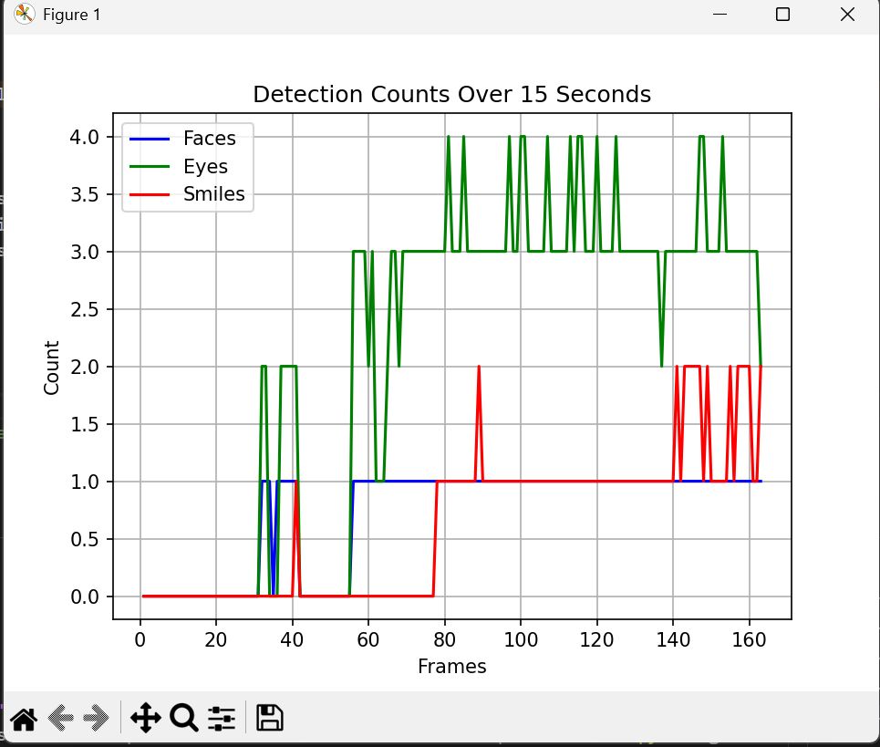

# Deteksi Wajah, Mata, dan Senyuman Real-Time Menggunakan OpenCV

Proyek ini menampilkan bagaimana cara melakukan deteksi fitur wajah secara real-time menggunakan pustaka OpenCV dan algoritma Haar Cascade Classifier. Fitur yang dapat dideteksi meliputi:
- Deteksi Wajah
- Deteksi Wajah dan Mata
- Deteksi Wajah dan Senyuman
- Deteksi Wajah, Mata, dan Senyuman sekaligus
- Visualisasi jumlah deteksi dalam bentuk grafik

## 📁 Daftar File Proyek
- `faceDetection.py`: Deteksi wajah melalui input kamera.
- `faceEyeDetection.py`: Deteksi wajah dan mata secara bersamaan.
- `faceSmileDetection.py`: Deteksi wajah dan senyuman.
- `faceEyeSmileDetection.py`: Deteksi lengkap (wajah, mata, dan senyum).
- `grafik.py`: Mencatat dan menampilkan grafik jumlah deteksi selama 15 detik.

## Tools yang Digunakan
- Python 3.x
- OpenCV (`cv2`)
- NumPy
- Matplotlib (khusus digunakan dalam `grafik.py`)
- Modul `time` (untuk timer grafik)

## Instalasi pustaka (jika belum tersedia):
`bash`
`pip install opencv-python numpy matplotlib`

